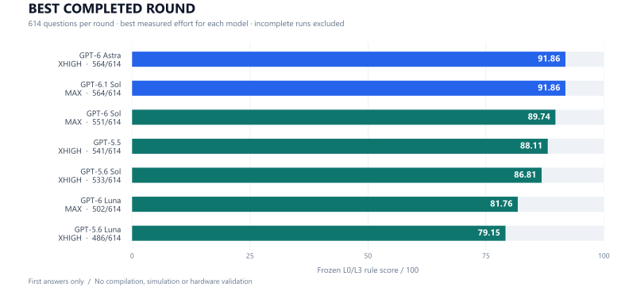

# EmbedEval · 嵌入式代码修复实测

**固定题库 · 每题独立会话 · 只计首次答案 · 原始答卷可核验**

[成绩总表](#完整轮次成绩) · [最新 Grok 记录](#grok-47-high) · [报告导航](#报告导航) · [本地核验](#本地核验)

| 题库 | 完整模型 | 完整轮次 | 完整轮次首答 |
|:---:|:---:|:---:|:---:|
| **614 题** | **7 款** | **17 组** | **10,438 份** |

> 本项目只执行冻结 **L0 静态检查 + L3 规则检查**。未编译、仿真或实机验证，规则分不等于真实修复率；这是独立实测，不是 EmbedEval 官方榜单。

## Grok 4.7 High

**2026-10-14 · 已停止 · 未完成完整轮次**

| 有效首答 / 计划题数 | 通过 / 已评分 | 已答题规则分 | 无最终答案 |
|:---:|:---:|:---:|:---:|
| **611 / 614** | **540 / 611** | **88.38** | **3 题** |

88.38 分的分母是 **611**，不与完整 614 题结果混排。第 310 题配置改名失败、第 506 题 TLS 连接断开、第 525 题长时间未返回后停止；均未重答。9 月 28 日的 6 份首答原样保留。

**[查看报告 →](results/grok-4.7-high-stopped-20261014.md)** · [逐题存档](answers/20261014-grok-4.7-high-stopped.jsonl) · [机器可读结果](results/grok-4.7-high-stopped-20261014.json)

## 完整轮次成绩

每个已测档位均覆盖 **614 题**。表格显示「百分制规则分 / 通过题数」；`—` 表示未测。模型顺序沿用 Low 与 Xhigh 两档均分顺序，Max 单列，不参与该排序。

| 模型 | Low | Xhigh（极高） | Max |
|:---|---:|---:|---:|
| **GPT-6 Astra** | 91.04 / 559 | **91.86 / 564** | — |
| **GPT-6.1 Sol** | 90.72 / 557 | 91.37 / 561 | **91.86 / 564** |
| GPT-6 Sol | 86.81 / 533 | 88.27 / 542 | **89.74 / 551** |
| GPT-5.5 | 84.85 / 521 | **88.11 / 541** | — |
| GPT-5.6 Sol | 83.88 / 515 | **86.81 / 533** | — |
| GPT-6 Luna | 80.29 / 493 | 81.11 / 498 | **81.76 / 502** |
| GPT-5.6 Luna | 78.18 / 480 | **79.15 / 486** | — |



图中取各模型**最高已测档位**，并非同一档位比较。Low/Xhigh 来自 2026-09-24、09-28、10-08 批次；Max 来自 10-09。不同日期、并发和平台条件下的耗时不能直接解释为模型本身速度差。GPT-6 Luna Xhigh 的 1 份首次输出格式异常按 0 分计入原完整轮次。

[Low/Xhigh 完整对比](results/seven-models-low-xhigh-20261008.md) · [三组 Max](results/max-614-20261009.md) · [成绩与历史价格](results/seven-models-scores-prices-20261009.md) · [耗时对比](results/seven-models-speed-20261009.md)

## 报告导航

| 想看什么 | 入口 | 口径 |
|:---|:---|:---|
| 七模型 Low / Xhigh | [完整对比](results/seven-models-low-xhigh-20261008.md) | 14 组 × 614 题 |
| 三模型 Max | [完整成绩](results/max-614-20261009.md) | 3 组 × 614 题 |
| Grok 4.7 High | [停止轮次](results/grok-4.7-high-stopped-20261014.md) | 611 份答卷，3 题无最终答案 |
| Claude Opus High | [Cursor 小样本](results/cursor-samples-20260928.md) | 30 题通过 29 题，不进入全量排行 |
| GPT-5.6 Terra Low | [暂停记录](results/partial-terra-low-20260928.json) | 127 份首答，无全量成绩 |
| 早期试跑 | [10 题矩阵](results/starter-10.json) | 38 组、380 份首答，小样本 |
| 首答与逐项评分 | [答卷目录](answers/README.md) | JSONL 原文、哈希与检查结果 |
| 数据与实验方法 | [题库](data/README.md) · [方法](docs/methodology.md) · [判题器局限](docs/grader-limitations.md) | 冻结题面和规则 |

价格和外部测速报告保留注明的 **2026-10-09 历史口径**。早期 SVG 动画与嵌入式问答综合题库未计入本仓库。已被完整轮次覆盖的 300 份暂停极高档答案及 Grok 早期 6 题样本只作历史审计，不重复计入完整轮次总数。

## 本地核验

Python 3.12+，下面的命令不需要模型密钥，不调用模型，也不改答案或分数。

```bash
python verify_results.py
python verify_six_models.py
python verify_gpt61.py
python verify_all_models.py
python verify_additional_results.py
python verify_grok_stopped.py
```

<details>
<summary><strong>继续跑新测试：安装与使用</strong></summary>

需要已登录的 Codex CLI 和固定版本上游检查器。Windows PowerShell：

```powershell
python -m venv .venv
.\.venv\Scripts\Activate.ps1
python -m pip install -r requirements.txt
python setup_upstream.py
python batch_runner.py doctor
python batch_runner.py prepare --run my-new-round --models gpt-6-luna --efforts low
python batch_runner.py run --run my-new-round --workers 4
python batch_runner.py status --run my-new-round
```

macOS/Linux 用 `source .venv/bin/activate` 激活环境。`prepare` 只建新轮次；`run` 会消耗账户额度。每道题第一次尝试即锁定，失败记录保留，不重答刷分。结果写入被 Git 忽略的 `.runs/`。指定模型和档位须由账户支持。参见 [复现与运行方法](docs/reproduce.md)；也可以通过 [网页评分器](server.py) 手动录入其他模型的首次答案。

</details>

---

题库来自 [EmbedEval](https://github.com/Ecro/embedeval) 提交 [`fdbcb9b`](https://github.com/Ecro/embedeval/tree/fdbcb9b93476149cce2d395532bf5164811fe053)：219 个基础案例生成 614 个 Bugfix 变体，并非 614 个独立工程任务。通过所有冻结 L0/L3 检查得 10 分，否则 0 分；完整轮次分数 = 通过题数 ÷ 614 × 100。

Apache-2.0 · [LICENSE](LICENSE) · [NOTICE](NOTICE) · 更新于 **2026-10-14**
